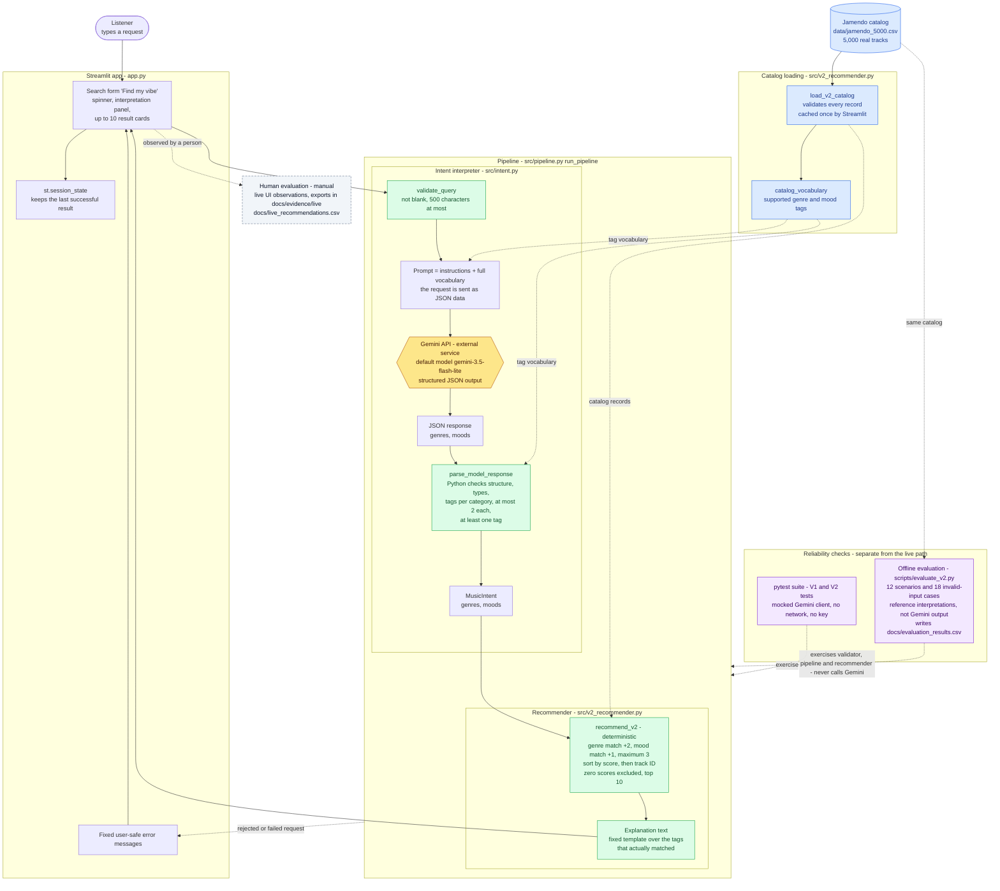

# 🎵 VibeMatch 2.0 — AI-Powered Music Discovery

## Project Summary

**VibeMatch 2.0** lets a listener describe the music they want in plain English, for example *"relaxing ambient music to listen to while reading"*, and returns up to ten matching tracks from a catalog of **5,000 real tracks** from the [MTG-Jamendo Dataset](https://github.com/MTG/mtg-jamendo-dataset). It is a Streamlit web app.

It is the second version of the CodePath AI110 Module 3 project **VibeMatch 1.0**, a small rule-based recommender over 20 synthetic songs. V1 is kept unchanged in this repository and is summarized below and preserved in full in [Appendix: VibeMatch 1.0](#appendix-vibematch-10-original-module-3-project).

**What the AI does, and what it does not do.** Google's Gemini model has one job: it reads the listener's sentence and picks matching **genre and mood tags that exist in the catalog**. Everything after that is ordinary deterministic code: a fixed scoring rule (**genre match +2, mood match +1, maximum score 3**) ranks the tracks, and a fixed template writes each explanation from the tags that actually matched. Gemini does not rank tracks, does not choose which tracks to show, and does not write the explanations. Its answer is re-checked in Python, and anything that is not a supported tag is rejected rather than repaired.

**What this project did not measure.** There is no measured accuracy or listener-satisfaction figure for the AI step. The evaluation reports rule-following and evidence consistency on fixed scenarios, plus five manually observed live searches (see [Testing and Reliability](#testing-and-reliability-summary) and [docs/EVALUATION.md](docs/EVALUATION.md)).

## Contents

1. [What changed from V1 to V2](#what-changed-from-v1-to-v2)
2. [Features actually implemented](#features-actually-implemented)
3. [Architecture overview](#architecture-overview)
4. [Technology stack](#technology-stack)
5. [Dataset and licensing](#dataset-and-licensing)
6. [Installation and setup](#installation-and-setup)
7. [Gemini API configuration](#gemini-api-configuration)
8. [Running the Streamlit app](#running-the-streamlit-app)
9. [Verified sample interactions](#verified-sample-interactions)
10. [Testing and reliability summary](#testing-and-reliability-summary)
11. [Limitations and known weaknesses](#limitations-and-known-weaknesses)
12. [Reflection and future improvements](#reflection-and-future-improvements)
13. [Project layout](#project-layout)
14. [Appendix: VibeMatch 1.0](#appendix-vibematch-10-original-module-3-project)

---

## What changed from V1 to V2

| | **VibeMatch 1.0** (original) | **VibeMatch 2.0** |
|---|---|---|
| Catalog | 20 synthetic songs (`data/songs.csv`) | 5,000 real Jamendo tracks (`data/jamendo_5000.csv`) |
| Input | A structured profile: favorite genre, favorite mood, target energy (0 to 1) | One free-text sentence (up to 500 characters) |
| AI | None | Gemini turns the sentence into catalog genre and mood tags |
| Scoring | Genre +2, mood +1, energy similarity up to +1 (maximum 4) | Genre +2, mood +1 (maximum 3). No energy term: the real catalog has no measured audio features, and none were invented |
| Matching | Exact text match, one genre and one mood per song | Exact tag match; each track has several genre and mood tags, and several requested tags count as alternatives (a category is credited once) |
| Output | Top 5 in the terminal | Up to 10 result cards in a web page, each with a score out of 3, a tag-based explanation, matched tags and a link to the Jamendo track |
| Interface | Command line (`python -m src.main`) | Streamlit (`app.py`) |
| Tests | 18 | 275 in total (the 18 V1 tests plus 257 for V2) |

**Relationship to V2.** V2 reuses V1's *conceptual* weighting (genre worth twice a mood) but is a separate implementation: `src/recommender.py` and `src/main.py` are untouched, and the V1 command-line program still produces output byte-identical to the saved baseline (`baseline_results.txt`).

## Features actually implemented

- **Natural-language search** in a Streamlit form (`st.form`, so typing does not trigger calls), with the button **Find my vibe** and a spinner while Gemini works.
- **Gemini intent interpretation** using the `google-genai` SDK with structured JSON output (a schema of `genres` and `moods`, at most 2 each). The complete genre and mood vocabulary of the loaded catalog is sent with every request, and the listener's text is sent separately as JSON data and treated as untrusted.
- **Independent Python validation** of Gemini's reply: structure, types, tag normalization and de-duplication, every genre in the genre vocabulary, every mood in the mood vocabulary, at most 2 per category, at least one tag overall. An invalid reply is never repaired or partially used.
- **Deterministic ranking** of the 5,000 tracks (genre +2, mood +1, ties broken by ascending track ID, zero-score tracks excluded, never padded to reach ten).
- **Evidence-backed explanations**: a fixed sentence template built only from the tags that matched, shown together with the matched genre and mood tags.
- **Result cards** (up to 10) with rank, title, artist, score out of 3, explanation, matched tags and a link to the original Jamendo track. Scores are labeled as a fixed rule, not an AI confidence, and the page states that no audio was analyzed.
- **Clear error and empty states** with fixed, user-safe messages: blank query, missing API key, Gemini failure, invalid model response, no usable interpretation, no matching tracks. Exception text, tracebacks and keys are never displayed.
- **Result persistence**: the last successful result stays on screen across unrelated Streamlit reruns without calling Gemini again; a new failed or empty search clears it so stale results are never shown as belonging to the new query.
- **Catalog caching**: the catalog is loaded and validated once per server process (`st.cache_resource`).
- **Reproducible dataset preparation** from official MTG-Jamendo metadata, documented in [docs/DATASET.md](docs/DATASET.md).
- **Automated tests and an offline evaluation** that need no API key or network, plus a recorded human evaluation sheet (ratings intentionally left blank).

**Not implemented** (nothing in this project does these): semantic or vector search, embeddings, retrieval-augmented generation (RAG), fine-tuning or training of any model, multi-agent orchestration, audio analysis or audio playback, album art, Spotify or any streaming-service integration, personalization from listening history, user accounts or authentication, a database, artist-diversification of the results, or automatic retry or fallback when Gemini fails.

## Architecture overview

The diagram below is also stored as [diagrams/architecture.mmd](diagrams/architecture.mmd) (the same Mermaid source). Solid arrows are the live request path; dotted arrows show data supplied to a step, or components that exercise the pipeline from outside it. The reliability checks and the manual human evaluation are separate from the live path.



**How a request flows** (module names refer to files in `src/`):

1. `app.py` receives the sentence from the form and calls `run_pipeline` (`src/pipeline.py`).
2. `interpret_intent` (`src/intent.py`) validates the query, builds the prompt (instructions plus the catalog vocabulary), and makes **one** Gemini call requesting structured JSON.
3. `parse_model_response` validates Gemini's JSON against the vocabulary and returns a `MusicIntent` (genres, moods), or raises a specific error.
4. `recommend_v2` (`src/v2_recommender.py`) scores every track, sorts, keeps the top 10 and attaches the template explanation and matched tags.
5. `app.py` renders the interpretation panel and the result cards, or a fixed error message.

The Jamendo catalog feeds both the **vocabulary** (what Gemini may choose from and what the validator accepts) and the **ranking** (the tracks that get scored).

## Technology stack

- **Python 3.13** (the version used for development and testing).
- **Streamlit** for the web interface.
- **google-genai** (Google's Gen AI SDK) for Gemini. Default model **`gemini-3.5-flash-lite`**, overridable with `GEMINI_MODEL`. Structured output uses `response_json_schema`; sampling settings are left at the model's defaults and the request timeout is 60 seconds.
- **pytest** for automated tests.
- Python standard library for catalog loading and dataset preparation (`csv`, `json`, `dataclasses`).
- **pandas** is listed in `requirements.txt` (inherited from the V1 starter) but is not imported by any current code.
- Data: [MTG-Jamendo Dataset](https://github.com/MTG/mtg-jamendo-dataset) metadata (not audio).

Pinned ranges are in [requirements.txt](requirements.txt).

## Dataset and licensing

The catalog [`data/jamendo_5000.csv`](data/jamendo_5000.csv) holds **5,000 real tracks** selected deterministically from the official MTG-Jamendo metadata files `raw_30s_cleantags.tsv` and `raw.meta.tsv`. Each row keeps the original Jamendo `track_id`, `title`, `artist`, `genres`, `moods`, `instruments` (JSON arrays; instruments may be empty) and `track_url`. **Nothing was invented**: there are no energy, tempo or valence values, and no audio is downloaded or redistributed.

| | |
|---|---|
| Source pool | 55,701 tracks in the tag file; 21,712 pass all eligibility rules (most are excluded for having no mood/theme tag) |
| Selected | 5,000 tracks by 1,538 artists (at most 5 per artist) |
| Vocabulary | 221 genres, 216 moods, 123 instruments |
| Selection | Deterministic, no random generator: tracks are grouped by their rarest genre, then taken round-robin with an artist cap, so results do not depend on source row order |

**License.** The upstream metadata is licensed **CC BY-NC-SA 4.0**, and the dataset is made available **solely for non-commercial research and academic use**. This catalog is derived from it and inherits those terms: attribute the MTG-Jamendo Dataset and Jamendo, use it only for non-commercial research or academic purposes (such as this course project), and share derivatives under the same license. Individual audio files on Jamendo carry their own Creative Commons licenses; this project does not use audio. Track links come from the dataset and are not guaranteed to still be online. The repository has no separate license file for the code.

**Citation:** Bogdanov, D., Won M., Tovstogan P., Porter A., & Serra X. (2019). *The MTG-Jamendo Dataset for Automatic Music Tagging.* Machine Learning for Music Discovery Workshop, ICML 2019.

Full provenance, checksums, eligibility counts and regeneration steps: [docs/DATASET.md](docs/DATASET.md). An earlier 2,500-track build (`data/jamendo_2500.csv`) was replaced by the 5,000-track file in the expansion commit and is no longer in the working tree; it remains in git history.

## Installation and setup

These commands were checked on macOS with Python 3.13. Other operating systems are untested.

```bash
# 1. Clone the repository
git clone https://github.com/bedouis/vibematch-v2.git
cd vibematch-v2

# 2. Create a Python 3.13 virtual environment and install the requirements
python3.13 -m venv .venv
source .venv/bin/activate
python -m pip install -r requirements.txt
```

The commands below call `.venv/bin/python` explicitly, so they also work without activating the environment.

**Run the automated tests (no API key or network needed):**

```bash
.venv/bin/python -m pytest -q
```

**Run the offline evaluation (no API key or network needed):**

```bash
.venv/bin/python scripts/evaluate_v2.py
```

This prints the scenario results and metrics and rewrites `docs/evaluation_results.csv` (the content is deterministic and matches the committed file). To avoid touching the committed file, add `--output /tmp/evaluation_check.csv`.

**Run the original V1 program:**

```bash
.venv/bin/python -m src.main
```

## Gemini API configuration

Live searches in the app need **a valid Gemini API key and network access**. The automated tests and the offline evaluation do **not**.

The app reads the key from the **`GEMINI_API_KEY` environment variable only**. It does not read `.env` or `.streamlit/secrets.toml` (both are git-ignored in case you create them, but nothing loads them). To set the key for one terminal session without typing it on the command line or storing it in shell history:

```bash
read -rs GEMINI_API_KEY && export GEMINI_API_KEY    # paste the key, press Enter (nothing is echoed)
```

Create a key in Google AI Studio. **Never commit a key or paste it into a file in this repository.** If a key is missing, the app still starts and tells the user to set `GEMINI_API_KEY` when a search is attempted.

Optional: choose a different model for one session:

```bash
export GEMINI_MODEL="your-model-id"     # default: gemini-3.5-flash-lite
```

The default `gemini-3.5-flash-lite` worked in live testing; `gemini-3.8-flash` returned an HTTP 504 (`DEADLINE_EXCEEDED`) in the same testing, and was therefore not used as the default. Model availability changes over time. The user's query text is sent to Google's Gemini API, so do not enter sensitive information.

## Running the Streamlit app

```bash
.venv/bin/python -m streamlit run app.py
```

Streamlit prints a local URL (normally http://localhost:8501). Type a request such as *Relaxing ambient music for reading*, press **Find my vibe**, and review the interpretation panel and result cards.

**Screenshot.** No screenshot is included in this repository yet. To add one, run the app, save a screenshot as `assets/vibematch-ui.png`, and reference it here; see [assets/README.md](assets/README.md). The text exports of the real pages that were captured are in [docs/evidence/live/](docs/evidence/live/README.md).

## Verified sample interactions

These are **observed** results from the real Streamlit app (live Gemini, the 5,000-track catalog, top 10). They come from the preserved page exports in [`docs/evidence/live/`](docs/evidence/live/README.md); the typed query text was recorded manually by the tester (the exports do not contain it), and Gemini's raw replies were not captured. Scores are the fixed rule, not an AI confidence. **No audio was listened to or analyzed**, so none of these results shows that the tracks actually sound relaxing, energetic or dark.

### 1. Success: relaxing ambient music ([export](docs/evidence/live/query1.md))

> *Tester-recorded query:* "I'm looking for relaxing ambient music to listen to while reading on a rainy afternoon."

**Observed:** Gemini interpretation shown in the UI: genre `ambient`, mood `relaxing`. Ten results, all scoring 3/3, by 7 distinct artists. The first three:

| # | Track | Artist | Score |
|---:|---|---|---:|
| 1 | New day | Alexander Blu | 3/3 |
| 2 | La gruta del agua | Carlos Saura | 3/3 |
| 3 | FEAT THE VIBE - The dream that you wanted | Alterlabel | 3/3 |

Each card's explanation reads "Matches your requested ambient genre and relaxing mood." Dreamweaver holds ranks 5 to 8, so one artist fills four of the ten places even though every score is perfect.

### 2. Success with limited artist diversity: energetic workout music ([export](docs/evidence/live/query2.md))

> *Tester-recorded query:* "I need something upbeat and energetic to keep me motivated during an intense workout."

**Observed:** no genre; moods `energetic` and `workout`. Ten results, all scoring **1/3**, by only **3 distinct artists** (POSITIV HATE ×4, Piergiorgio Lucidi ×5, St Adam ×1). The first three:

| # | Track | Artist | Score |
|---:|---|---|---:|
| 1 | Virtual defect | POSITIV HATE | 1/3 |
| 2 | Hymn of Darkness | POSITIV HATE | 1/3 |
| 3 | Destruction of christrian's dream | POSITIV HATE | 1/3 |

A request with only moods can score at most 1 out of 3, because genre points are unavailable, and all ten tracks tie, so the lowest track IDs win and one artist's uploads cluster together. The explanations cite only `energetic`; none of the ten tracks carries the `workout` tag. This is the clearest live example of the diversity weakness described below.

### 3. Validation failure: dark atmospheric electronic music ([export](docs/evidence/live/query3.md))

> *Tester-recorded query:* "I'm in the mood for dark, atmospheric electronic music with a cinematic feeling."

**Observed:** no results. The page showed: *"Gemini's answer couldn't be verified against our catalog, so it was discarded. Try rephrasing your request."* The raw reply was not captured, so the exact cause is **unknown** and should not be attributed to any particular tag. The safeguard worked as designed (an unverified interpretation never reached ranking), but the user had to rephrase: a safety-versus-availability trade-off, not a successful search.

### Also observed

- **Peaceful, relaxing rock** ([export](docs/evidence/live/query4.md)): genre `rock`, moods `peaceful` and `relaxing`; nine results at 3/3 and one at 2/3, by 6 distinct artists (Ant_DK holds ranks 4 to 8).
- **Traditional zydeco with accordion** ([export](docs/evidence/live/query5.md)): the app showed "We couldn't match that to a genre or mood in our catalog" and returned nothing, rather than showing unrelated tracks.

Across all five live searches: 3 returned track lists, 1 was rejected as unverifiable, 1 produced no usable interpretation. That is five hand-picked observations, **not** an accuracy or success rate. Per-query detail, with the observed/recorded/not-captured distinctions: [docs/EVALUATION.md](docs/EVALUATION.md#5-live-gemini-evaluation--five-observed-searches).

## Testing and reliability summary

**Automated tests: 275 pass** (`.venv/bin/python -m pytest -q`; no API key, no network; network access is blocked inside the test files that could reach it).

| File | Tests | What it covers |
|---|---:|---|
| `tests/test_recommender.py` | 18 | Original V1 behavior |
| `tests/test_jamendo_data.py` | 25 | Dataset parsing, eligibility, deterministic selection, generated catalog |
| `tests/test_v2_recommender.py` | 56 | Catalog loading and validation, scoring, ranking, ties, explanations |
| `tests/test_intent.py` | 73 | Gemini request configuration and response validation, with a mocked client |
| `tests/test_pipeline.py` | 41 | Orchestration, error contract, one Gemini call per request |
| `tests/test_app.py` | 28 | Streamlit behavior, error messages, result persistence (Streamlit `AppTest`) |
| `tests/test_evaluation.py` | 34 | Offline evaluation harness and live-evidence consistency |

**Offline evaluation** ([docs/EVALUATION.md](docs/EVALUATION.md), [docs/evaluation_results.csv](docs/evaluation_results.csv)): 12 scenarios and 18 invalid-input cases, run through the real validator, pipeline and recommender. The interpretations in these runs are **human-chosen references or hand-written invalid candidates, not Gemini outputs**.

| Metric | Result |
|---|---|
| Offline execution success | 12/12 |
| Ranking correctness (independent recomputation) | 10/10 result sets |
| Evidence consistency (matched tags and explanation) | 91/91 recommendations |
| Recommendation coverage of valid scenarios | 10/10 |
| Invalid scenarios / invalid-input cases rejected | 2/2 and 18/18 |
| Artist diversity at 10 (distinct artists ÷ returned tracks) | mean 0.650 over all 10 result sets; **0.611** over the 9 full 10-track lists (S10 has one result); lowest 0.400 |

The 100% figures are **rule-conformance checks of deterministic code, not accuracy claims**. Artist diversity is the informative result and shows a weakness.

**Live observations** (five searches, see *Verified sample interactions*): 3 lists, 1 rejection, 1 no-interpretation message; artist diversity 0.70, 0.30 and 0.60 for the three lists (mean 0.533). A human rating sheet exists in the evaluation document with ratings **left blank**; no human ratings have been collected.

**Safeguards in the code:** query validation, structured JSON output, Python validation of every reply, rejection (never repair) of unsupported tags, one Gemini call per request, fixed error messages, deterministic ranking, no zero-score filler, explanations from a fixed template, no keys in the repository. The full table with the tests that cover each is in [docs/EVALUATION.md](docs/EVALUATION.md#7-reliability-safeguards-implemented).

## Limitations and known weaknesses

- **AI quality is not measured.** How often Gemini picks appropriate tags on this catalog is unknown. The five live observations are a small, hand-picked sample, and the exports lack Gemini's raw replies.
- **Artist repetition.** Ties are broken only by track ID, so one artist's consecutive uploads can fill a top 10 (observed: 3 distinct artists in the workout search; offline scenarios as low as 4). No diversification is implemented.
- **A requested mood can go unmatched.** For "calm death metal" no track has both tags, so all ten results are death metal without `calm`. The scores and explanations are honest, but the interpretation panel still lists *calm*.
- **Coarse scores.** Only 0, 1, 2 or 3 are possible, so large groups tie. Mood-only requests cap at 1 out of 3.
- **Strict rejection.** One unsupported or misplaced tag from Gemini rejects the whole reply and the user must rephrase (observed once in five live searches). There is no retry or fallback.
- **Sparse tags.** Some tags are very rare ("metalcore" occurs on 1 track), so some searches return short lists, which are never padded.
- **Tags are uploader-provided and subjective.** The ranking reflects catalog tags, not sound. The "mood/theme" tag set also contains non-mood labels such as countries and topics, so some mood tags do not describe how music feels.
- **Catalog scope.** 5,000 tracks chosen for tag and artist variety do not represent Jamendo or music in general; only tracks that carry a mood tag were eligible (about 39% of the source tracks). Links may be stale.
- **English-language testing only.** Other languages were not tested.
- **Privacy.** Query text is sent to Google's Gemini API. The app stores nothing beyond the current browser session.
- **Environment.** The key is read from an environment variable only. `pandas` is listed in `requirements.txt` but unused.

More detail, including dataset and representation bias: the [model card](model_card.md) and [docs/EVALUATION.md](docs/EVALUATION.md).

## Reflection and future improvements

**What I learned.** The most important decisions were not about making the AI more capable but about deciding what it should be responsible for, how to verify its output, and how to evaluate the system honestly. I chose a hybrid design: Gemini interprets the user's language, and Python does the ranking, scoring and explanations from verified catalog attributes, because that keeps the system testable, explainable and reproducible.

Strict validation turned out to involve a trade-off. When Gemini's answer to the dark, atmospheric electronic request could not be verified against the catalog, the safeguard worked, but the user was left with a failed search for a reasonable request. Correct behavior and a good experience are not the same thing.

Evaluation taught me the same lesson: 275 passing tests showed the code follows its rules, but the live searches exposed what tests could not, such as ten workout results from only three artists. Because VibeMatch does not analyze audio, matching tags does not show that a song actually sounds relaxing or energetic. I also learned to review AI-generated changes critically and require evidence before accepting them.

The full reflection is in the [model card, Section 16](model_card.md#16-personal-reflection-what-i-learned-building-vibematch-20).

**Future improvements** (none of these exist yet):

1. Limit repeats of the same artist within a result list, and break ties in a way that does not favor the oldest uploads.
2. When Gemini's reply is rejected, retry once or fall back to asking the user to choose from supported tags, instead of only asking them to rephrase.
3. Constrain the allowed tags inside the response schema (not yet tested against the live API) to reduce rejections.
4. Show, when a requested tag matches no result in the top list (as with *calm* in the death metal example), that it went unmatched.
5. Collect real human ratings with the provided sheet, and run a larger set of live queries against the 5,000-track catalog.
6. Evaluate relevance by listening, since tags alone say nothing about sound.
7. Record raw model replies and model version for each live run so failures such as the rejected dark-electronic search can be diagnosed.

## Project layout

| Path | Purpose |
|---|---|
| `app.py` | Streamlit interface |
| `src/intent.py` | Gemini intent interpreter and response validation |
| `src/pipeline.py` | Query to intent to ranking orchestration |
| `src/v2_recommender.py` | V2 catalog loading, vocabulary, scoring, ranking, explanations |
| `src/recommender.py`, `src/main.py` | **V1** recommender and command-line program (unchanged) |
| `data/jamendo_5000.csv` | V2 catalog (5,000 Jamendo tracks) |
| `data/songs.csv` | V1 catalog (20 songs) |
| `scripts/prepare_jamendo.py` | Rebuilds the catalog from Jamendo metadata |
| `scripts/evaluate_v2.py` | Offline reliability evaluation |
| `docs/DATASET.md` | Dataset provenance, licensing, statistics |
| `docs/EVALUATION.md` | Evaluation method, results, live observations, human rating sheet |
| `docs/evaluation_results.csv`, `docs/live_recommendations.csv` | Offline results; hand-recorded live results |
| `docs/evidence/live/` | Preserved exports of the five live searches |
| `diagrams/architecture.mmd` | Architecture diagram (Mermaid source) |
| `model_card.md` | Model card (V2, with the V1 card preserved) |
| `ai_interactions.md` | Log of AI assistance |
| `tests/` | Automated tests |
| `baseline_results.txt`, `experiment_results.txt` | V1 reference outputs |

---

## Appendix: VibeMatch 1.0 (original Module 3 project)

> **Preserved from the original V1 README.** Everything below describes **VibeMatch 1.0** only: the rule-based recommender over 20 songs, run with `python -m src.main`. Its code (`src/recommender.py`, `src/main.py`), data (`data/songs.csv`) and reference outputs (`baseline_results.txt`, `experiment_results.txt`) are unchanged in V2. The only edits to this text are one-level heading demotion and three sentences whose references to the model card were updated for its new layout.

### Project Summary

**Music Recommender Simulation** (model name: **VibeMatch 1.0**) is a small, rule-based music recommender written in Python. A listener states a favorite genre, a favorite mood and a target energy level. The program scores each of the 20 songs in `data/songs.csv` against those preferences (up to 4 points: 2 for genre, 1 for mood, and up to 1 for how close the energy is), ranks the songs, and prints the top five with a plain-language reason for each score.

It is a content-based system built on hand-set rules, not a trained machine-learning model. We evaluated it on five user profiles (three standard and two adversarial), ran a weight-shift experiment, and documented what we found. 18 automated tests check ranking, scoring, result limits, explanations, tie-breaking and consistency. We did not measure listener satisfaction or recommendation accuracy, so the results describe how the algorithm behaves, not how well it predicts what people enjoy.

For the full write-up, see the [Model Card](model_card.md) (its appendix preserves the complete V1 card).

---

### How The System Works

The design below is implemented in `src/recommender.py` and run by `src/main.py`.

#### Overview

This is a **content-based** recommender. It compares each song's own attributes to what a user says they like, and it needs no data from other listeners. Every song gets a score for how well it fits the user, the songs are sorted by score, and the best few are returned.

#### Dataset

The catalog is `data/songs.csv`, with **20 songs**. Each row has an id, title, artist, and these attributes:

- `genre` and `mood`: text labels (e.g., pop, lofi, rock; happy, chill, intense)
- `energy`: a number from 0.0 to 1.0
- `tempo_bpm`, `valence`, `danceability`, `acousticness`: also available, but the scoring rule does not use them

#### User profile

A user is described by a dictionary with three attributes:

```python
user_prefs = {
    "favorite_genre": "pop",    # the genre the user prefers
    "favorite_mood": "happy",   # the mood the user prefers
    "target_energy": 0.80,      # 0.0 to 1.0, the energy level the user wants
}
```

#### Scoring formula

```
score = 2 * genre_match + mood_match + (1 - abs(song_energy - target_energy))
```

- `genre_match` and `mood_match` are 1 if the song's value equals the user's (ignoring capitalization and extra spaces), otherwise 0.
- The energy term is 1.0 for a perfect match and shrinks as the gap grows.
- Scores range from **0.0 to 4.0**. For example, "Sunrise City" (pop, happy, 0.82) scores 2 + 1 + 0.98 = **3.98** for the profile above.

#### From scoring to recommendations

1. **Score each song.** The system loads the CSV into a list of dictionaries and loops over every song. For each one it applies the formula and records the score with a short explanation (e.g., "genre match (+2.0), energy similarity (+0.98)"). Each song is scored on its own, without reference to the others.
2. **Rank the catalog.** Once every song has a score, the list is sorted from highest to lowest. If two songs have the same score, the one with the lower song ID comes first, so the same input always gives the same output.
3. **Return the top K.** The first K songs are kept and printed to the terminal with their titles, scores, and reasons.

The same logic is also available as a `Recommender` class (`recommend()` and `explain_recommendation()`), which reuses `score_song()` and `recommend_songs()` instead of repeating the scoring rules.

#### Data flow


#### Limitations of the design

- **Genre dominance.** A genre match is worth 2.0, twice as much as a mood match and more than the entire energy term can contribute. A song in the right genre will almost always beat a song in the wrong genre, even if the wrong-genre song matches the user's mood and energy better.
- **Exact matching.** Genre and mood are compared as exact text, so related labels get no partial credit. A "pop" listener gets nothing for "indie pop," so in the High-Energy Pop run a happy indie pop song (*Rooftop Lights*, 1.91) scores below an intense pop song (*Gym Hero*, 2.92).
- **Limited diversity.** With only 20 songs, most genres appear once. A user with a niche favorite will always see that one song first however poorly it fits, and the rest of the top K fills up with weak matches. Different users will often see the same handful of songs.
- **Filter bubbles.** The system rewards songs that look like what the user already said they like, and nothing in the design pushes it to suggest something different. Users could keep seeing more of the same genre and mood and never discover other kinds of music. This is a hypothesis; we did not test it.

The first three were observed in our tests (see Limitations and Risks below and the Model Card).

---

### Getting Started

#### Setup

1. Create a virtual environment (optional but recommended):

   ```bash
   python -m venv .venv
   source .venv/bin/activate      # Mac or Linux
   .venv\Scripts\activate         # Windows
   ```

2. Install dependencies

```bash
pip install -r requirements.txt
```

3. Run the app:

```bash
python -m src.main
```

#### Running Tests

Run the automated tests (18 tests) with:

```bash
python -m pytest -q
```

They are in `tests/test_recommender.py` and cover ranking order, scoring values, result limits, explanations, tie-breaking, and consistency between the `Recommender` class and the functional code.

---

### Sample Recommendation Output

Run the recommender from the repository root:

```bash
python -m src.main
```

The program loads `data/songs.csv`, then prints the top five recommendations for each of five built-in user profiles. For every song it shows the rank, title, artist, score out of 4.00, and the reasons behind the score. The full terminal output for each profile is in [Recommendation Evaluation — User Profiles](#recommendation-evaluation--user-profiles) below.

---

### Recommendation Evaluation — User Profiles

Baseline run with the original scoring weights (genre +2.0, mood +1.0, energy similarity up to +1.0). Command: `python -m src.main`. Each block below is the program's actual terminal output for one profile, split at the profile boundaries.

#### High-Energy Pop

- Genre: `pop`
- Mood: `happy`
- Target energy: `0.85`

```text
Profile: High-Energy Pop (genre=pop, mood=happy, target energy=0.85)
============================================================
Top recommendations
============================================================

#1  Sunrise City by Neon Echo
    Score: 3.97 / 4.00
    Why:
      - genre match (+2.0)
      - mood match (+1.0)
      - energy similarity (+0.97)

#2  Gym Hero by Max Pulse
    Score: 2.92 / 4.00
    Why:
      - genre match (+2.0)
      - energy similarity (+0.92)

#3  Rooftop Lights by Indigo Parade
    Score: 1.91 / 4.00
    Why:
      - mood match (+1.0)
      - energy similarity (+0.91)

#4  Calle Luna by Los Faroles
    Score: 0.99 / 4.00
    Why:
      - energy similarity (+0.99)

#5  Storm Runner by Voltline
    Score: 0.94 / 4.00
    Why:
      - energy similarity (+0.94)
```

#### Chill Lofi

- Genre: `lofi`
- Mood: `chill`
- Target energy: `0.4`

```text
Profile: Chill Lofi (genre=lofi, mood=chill, target energy=0.4)
============================================================
Top recommendations
============================================================

#1  Midnight Coding by LoRoom
    Score: 3.98 / 4.00
    Why:
      - genre match (+2.0)
      - mood match (+1.0)
      - energy similarity (+0.98)

#2  Library Rain by Paper Lanterns
    Score: 3.95 / 4.00
    Why:
      - genre match (+2.0)
      - mood match (+1.0)
      - energy similarity (+0.95)

#3  Focus Flow by LoRoom
    Score: 3.00 / 4.00
    Why:
      - genre match (+2.0)
      - energy similarity (+1.00)

#4  Spacewalk Thoughts by Orbit Bloom
    Score: 1.88 / 4.00
    Why:
      - mood match (+1.0)
      - energy similarity (+0.88)

#5  Coffee Shop Stories by Slow Stereo
    Score: 0.97 / 4.00
    Why:
      - energy similarity (+0.97)
```

#### Deep Intense Rock

- Genre: `rock`
- Mood: `intense`
- Target energy: `0.92`

```text
Profile: Deep Intense Rock (genre=rock, mood=intense, target energy=0.92)
============================================================
Top recommendations
============================================================

#1  Storm Runner by Voltline
    Score: 3.99 / 4.00
    Why:
      - genre match (+2.0)
      - mood match (+1.0)
      - energy similarity (+0.99)

#2  Gym Hero by Max Pulse
    Score: 1.99 / 4.00
    Why:
      - mood match (+1.0)
      - energy similarity (+0.99)

#3  Pulse Horizon by Static Bloom
    Score: 0.96 / 4.00
    Why:
      - energy similarity (+0.96)

#4  Iron Cathedral by Black Meridian
    Score: 0.94 / 4.00
    Why:
      - energy similarity (+0.94)

#5  Calle Luna by Los Faroles
    Score: 0.92 / 4.00
    Why:
      - energy similarity (+0.92)
```

#### Conflicting Preferences

- Genre: `classical`
- Mood: `intense`
- Target energy: `0.95`

```text
Profile: Conflicting Preferences (genre=classical, mood=intense, target energy=0.95)
============================================================
Top recommendations
============================================================

#1  Winter Nocturne by Elena Varga
    Score: 2.23 / 4.00
    Why:
      - genre match (+2.0)
      - energy similarity (+0.23)

#2  Gym Hero by Max Pulse
    Score: 1.98 / 4.00
    Why:
      - mood match (+1.0)
      - energy similarity (+0.98)

#3  Storm Runner by Voltline
    Score: 1.96 / 4.00
    Why:
      - mood match (+1.0)
      - energy similarity (+0.96)

#4  Pulse Horizon by Static Bloom
    Score: 0.99 / 4.00
    Why:
      - energy similarity (+0.99)

#5  Iron Cathedral by Black Meridian
    Score: 0.97 / 4.00
    Why:
      - energy similarity (+0.97)
```

#### Absent Genre

- Genre: `k-pop`
- Mood: `happy`
- Target energy: `0.8`

```text
Profile: Absent Genre (genre=k-pop, mood=happy, target energy=0.8)
============================================================
Top recommendations
============================================================

#1  Sunrise City by Neon Echo
    Score: 1.98 / 4.00
    Why:
      - mood match (+1.0)
      - energy similarity (+0.98)

#2  Rooftop Lights by Indigo Parade
    Score: 1.96 / 4.00
    Why:
      - mood match (+1.0)
      - energy similarity (+0.96)

#3  Calle Luna by Los Faroles
    Score: 0.96 / 4.00
    Why:
      - energy similarity (+0.96)

#4  Night Drive Loop by Neon Echo
    Score: 0.95 / 4.00
    Why:
      - energy similarity (+0.95)

#5  Storm Runner by Voltline
    Score: 0.89 / 4.00
    Why:
      - energy similarity (+0.89)
```

---

### Experiments You Tried

#### Weight shift: genre 2.0 → 1.0, energy 1.0 → 2.0

We changed the score to `1.0 * genre_match + 1.0 * mood_match + 2.0 * energy_similarity` (maximum still 4.0) and reran all five profiles. This was an evaluation experiment only: the original weights (2.0 / 1.0 / 1.0) are restored and are what the program uses. The raw outputs are in `baseline_results.txt` and `experiment_results.txt`.

| Profile | Baseline #1 | Experimental #1 | Ranking changed? |
|---|---|---|---|
| High-Energy Pop | Sunrise City, 3.97 | Sunrise City, 3.94 | No |
| Chill Lofi | Midnight Coding, 3.98 | Midnight Coding, 3.96 | No |
| Deep Intense Rock | Storm Runner, 3.99 | Storm Runner, 3.98 | No |
| Conflicting Preferences | Winter Nocturne, 2.23 | Gym Hero, 2.96 | **Yes** |
| Absent Genre | Sunrise City, 1.98 | Sunrise City, 2.96 | No |

- Four of the five profiles kept exactly the same full 20-song ranking; only their scores changed.
- Conflicting Preferences was the only profile whose ranking changed: Winter Nocturne fell from #1 to #10, Gym Hero rose to #1, and 10 of the 20 songs changed position.
- Experimental scores ranged from 0.52 to 3.98, within the valid 0 to 4 range.

#### Different types of users

We tested three standard profiles (High-Energy Pop, Chill Lofi, Deep Intense Rock) and two adversarial ones: Conflicting Preferences (classical / intense / 0.95) and Absent Genre (k-pop / happy / 0.8). The standard profiles gave strong top results. Under the original weights, the conflicting profile ranked a quiet classical piece first, and the absent-genre profile had no genre match available, so its lower places were filled by energy alone.

#### Not tried

We did not add tempo, valence or other features to the score, and we did not test any other weight settings.

---

### Limitations and Risks

**Observed in our tests**

- **Genre dominance:** with the original weights, a quiet classical song (Winter Nocturne, energy 0.18) ranked first for a listener targeting energy 0.95, and Focus Flow (lofi, "focused") outranked Spacewalk Thoughts (ambient, chill) for a chill listener.
- **Exact matching:** "pop" and "indie pop" are unrelated labels, so related genres get no partial credit.
- **Tiny catalog:** 15 of the 17 genres have only one song, and in the baseline results 11 of the 25 top-five slots went to songs that matched neither genre nor mood.
- **No warning for a missing genre:** the k-pop profile got a normal-looking list with no notice that nothing matched.

**Not tested (hypothetical)**

- Filter bubbles, where listeners keep seeing only familiar styles.
- Whether the system treats different groups of listeners unequally.

**Not measured:** listener satisfaction or recommendation accuracy. The system also ignores lyrics, language, tempo and the other data columns. See the V1 limitations section in the appendix of the [Model Card](model_card.md) for more.

---

### Reflection

For the full write-up, see the [**Model Card**](model_card.md) (its appendix preserves the complete V1 card).

This project helped me understand how a recommendation system can translate user preferences into numerical scores and ranked results without requiring a complex machine-learning model. One of my biggest learning moments was realizing how strongly the choice of scoring weights influences the behavior of an algorithm. A relatively simple formula could produce seemingly personalized recommendations while also generating unexpected results when different preferences conflicted.

The most surprising result came from the weight-shift experiment. I expected changing the relative importance of genre and energy to affect several recommendation lists, but four of the five profiles retained exactly the same rankings. Only the conflicting-preferences profile changed significantly, with Winter Nocturne falling from first to tenth place. This demonstrated that changes to an algorithm do not necessarily affect every user or produce universally better recommendations.
