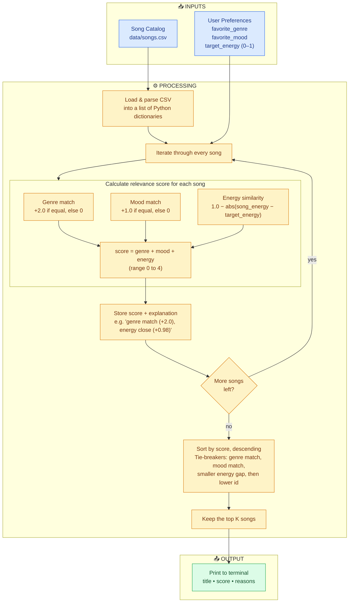

# 🎵 Music Recommender Simulation

## Project Summary

In this project you will build and explain a small music recommender system.

Your goal is to:

- Represent songs and a user "taste profile" as data
- Design a scoring rule that turns that data into recommendations
- Evaluate what your system gets right and wrong
- Reflect on how this mirrors real world AI recommenders

Replace this paragraph with your own summary of what your version does.

---

## How The System Works

This section describes the **planned design** of the recommender. It is a plan for the implementation, not a description of finished code.

### Approach: content-based recommendation

The system is content-based: it recommends songs by comparing each song's own attributes (genre, mood, energy) to a user's stated preferences. It does not use other users' listening history, so it needs no data about anyone but the current user.

### Dataset

The catalog is `data/songs.csv`, containing **20 songs**. Each row has an id, title, artist, and several audio features. The features relevant to scoring are:

- `genre`: categorical label (e.g., pop, lofi, rock)
- `mood`: categorical label (e.g., happy, chill, intense)
- `energy`: float from 0.0 to 1.0

The other columns (`tempo_bpm`, `valence`, `danceability`, `acousticness`) are available but not used in the first version of the scoring rule.

### User preferences

A user's taste is represented as a dictionary with three attributes:

```python
user_prefs = {
    "favorite_genre": "pop",    # genre the user prefers
    "favorite_mood": "happy",   # mood the user prefers
    "target_energy": 0.80,      # float 0.0 to 1.0, the energy level the user wants
}
```

### Scoring formula

```
score = 2 * genre_match + mood_match + (1 - abs(song_energy - target_energy))
```

- `genre_match` is 1 if the song's genre equals `favorite_genre`, otherwise 0.
- `mood_match` is 1 if the song's mood equals `favorite_mood`, otherwise 0.
- The energy term is 1.0 for a perfect energy match and shrinks as the gap grows.
- Scores range from **0.0 to 4.0**.

Example: for a user who wants pop / happy / 0.80, "Sunrise City" (pop, happy, 0.82) scores 2 + 1 + 0.98 = **3.98**.

### Scoring vs. ranking

These are two separate steps:

1. **Scoring** works on one song at a time. The formula takes a single song and the user's preferences and returns a number and a short explanation. It knows nothing about the other songs.
2. **Ranking** works on the whole catalog. After every song has been scored, the list is sorted by score from highest to lowest, and the top K songs are returned.

Ties are broken deterministically so the same input always produces the same output. Songs are sorted by score (rounded to 6 decimals), then genre match, then mood match, then smaller energy gap, then lower `id`.

### Data flow



### Expected limitations and potential biases

Exact string matching on genre means closely related genres get no partial credit. A "pop" listener receives nothing for "indie pop" songs like *Rooftop Lights*, so a happy indie pop track scores 1.96 while an intense pop track like *Gym Hero* scores 2.87. The genre weight is also large: a genre-only match (worth at least 2.0) will almost always outrank a mood-only match (at most 2.0), so mood and energy mostly reorder songs *within* a genre instead of competing with it. With only 20 songs, most genres appear exactly once, so a user with a niche favorite genre will always see that one song first no matter how poorly its mood and energy fit, and the top-K list quickly fills with weak matches. The small catalog also limits diversity: the same few songs surface for many different profiles, and users whose tastes fall outside the covered genres are underserved. These behaviors are expected from the design and are meant to be tested later in the project.

---

## Getting Started

### Setup

1. Create a virtual environment (optional but recommended):

   ```bash
   python -m venv .venv
   source .venv/bin/activate      # Mac or Linux
   .venv\Scripts\activate         # Windows

2. Install dependencies

```bash
pip install -r requirements.txt
```

3. Run the app:

```bash
python -m src.main
```

### Running Tests

Run the starter tests with:

```bash
pytest
```

You can add more tests in `tests/test_recommender.py`.

---

## Sample Recommendation Output

Paste a sample of your recommender's output here as a text block so a reader can see what it produces:

```
# e.g.:
# User profile: genre=indie, mood=chill, energy=low
# Recommendations:
#   1. ...
#   2. ...
#   3. ...
```

**Screenshot or video** *(optional)*: <!-- Insert a screenshot or demo video link here -->

---

## Experiments You Tried

Use this section to document the experiments you ran. For example:

- What happened when you changed the weight on genre from 2.0 to 0.5
- What happened when you added tempo or valence to the score
- How did your system behave for different types of users

---

## Limitations and Risks

Summarize some limitations of your recommender.

Examples:

- It only works on a tiny catalog
- It does not understand lyrics or language
- It might over favor one genre or mood

You will go deeper on this in your model card.

---

## Reflection

Read and complete `model_card.md`:

[**Model Card**](model_card.md)

Write 1 to 2 paragraphs here about what you learned:

- about how recommenders turn data into predictions
- about where bias or unfairness could show up in systems like this


