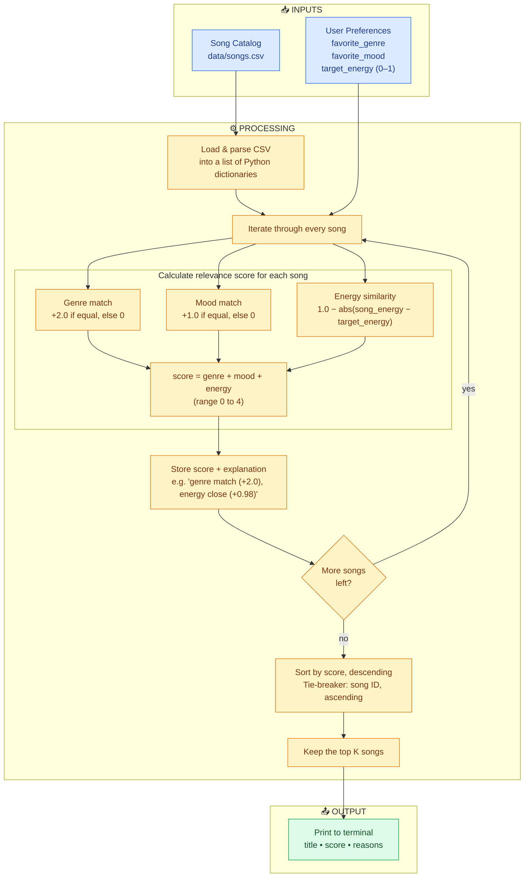

# 🎵 Music Recommender Simulation

## Project Summary

In this project you will build and explain a small music recommender system.

Your goal is to:

- Represent songs and a user "taste profile" as data
- Design a scoring rule that turns that data into recommendations
- Evaluate what your system gets right and wrong
- Reflect on how this mirrors real world AI recommenders

Replace this paragraph with your own summary of what your version does.

---

## How The System Works

This section describes the **planned design**. It is a plan for the implementation, not a description of finished code.

### Overview

This is a **content-based** recommender. It compares each song's own attributes to what a user says they like, and it needs no data from other listeners. Every song gets a score for how well it fits the user, the songs are sorted by score, and the best few are returned.

### Dataset

The catalog is `data/songs.csv`, with **20 songs**. Each row has an id, title, artist, and these attributes:

- `genre` and `mood`: text labels (e.g., pop, lofi, rock; happy, chill, intense)
- `energy`: a number from 0.0 to 1.0
- `tempo_bpm`, `valence`, `danceability`, `acousticness`: also available, but the first version of the scoring rule does not use them

### User profile

A user is described by a dictionary with three attributes:

```python
user_prefs = {
    "favorite_genre": "pop",    # the genre the user prefers
    "favorite_mood": "happy",   # the mood the user prefers
    "target_energy": 0.80,      # 0.0 to 1.0, the energy level the user wants
}
```

### Scoring formula

```
score = 2 * genre_match + mood_match + (1 - abs(song_energy - target_energy))
```

- `genre_match` and `mood_match` are 1 if the song's value equals the user's, otherwise 0.
- The energy term is 1.0 for a perfect match and shrinks as the gap grows.
- Scores range from **0.0 to 4.0**. For example, "Sunrise City" (pop, happy, 0.82) scores 2 + 1 + 0.98 = **3.98** for the profile above.

### From scoring to recommendations

1. **Score each song.** The system loads the CSV into a list of dictionaries and loops over every song. For each one it applies the formula and records the score with a short explanation (e.g., "genre match +2.0, energy close +0.98"). Each song is scored on its own, without reference to the others.
2. **Rank the catalog.** Once every song has a score, the list is sorted from highest to lowest. If two songs have the same score, the one with the lower song ID comes first, so the same input always gives the same output.
3. **Return the top K.** The first K songs are kept and printed to the terminal with their titles, scores, and reasons.

### Data flow



### Expected limitations

- **Genre dominance.** A genre match is worth 2.0, twice as much as a mood match and more than the entire energy term can contribute. A song in the right genre will almost always beat a song in the wrong genre, even if the wrong-genre song matches the user's mood and energy better.
- **Exact matching.** Genre and mood are compared as exact text, so related labels get no partial credit. A "pop" listener gets nothing for "indie pop," so a happy indie pop song (*Rooftop Lights*, 1.96) scores below an intense pop song (*Gym Hero*, 2.87).
- **Limited diversity.** With only 20 songs, most genres appear once. A user with a niche favorite will always see that one song first however poorly it fits, and the rest of the top K fills up with weak matches. Different users will often see the same handful of songs.
- **Filter bubbles.** The system rewards songs that look like what the user already said they like, and nothing in the design pushes it to suggest something different. Users would keep seeing more of the same genre and mood, and would never discover other kinds of music.

These are expected consequences of the design, and they are meant to be tested and discussed later in the project.

---

## Getting Started

### Setup

1. Create a virtual environment (optional but recommended):

   ```bash
   python -m venv .venv
   source .venv/bin/activate      # Mac or Linux
   .venv\Scripts\activate         # Windows

2. Install dependencies

```bash
pip install -r requirements.txt
```

3. Run the app:

```bash
python -m src.main
```

### Running Tests

Run the starter tests with:

```bash
pytest
```

You can add more tests in `tests/test_recommender.py`.

---

## Sample Recommendation Output

Paste a sample of your recommender's output here as a text block so a reader can see what it produces:

```
# e.g.:
# User profile: genre=indie, mood=chill, energy=low
# Recommendations:
#   1. ...
#   2. ...
#   3. ...
```

**Screenshot or video** *(optional)*: <!-- Insert a screenshot or demo video link here -->

---

## Experiments You Tried

Use this section to document the experiments you ran. For example:

- What happened when you changed the weight on genre from 2.0 to 0.5
- What happened when you added tempo or valence to the score
- How did your system behave for different types of users

---

## Limitations and Risks

Summarize some limitations of your recommender.

Examples:

- It only works on a tiny catalog
- It does not understand lyrics or language
- It might over favor one genre or mood

You will go deeper on this in your model card.

---

## Reflection

Read and complete `model_card.md`:

[**Model Card**](model_card.md)

Write 1 to 2 paragraphs here about what you learned:

- about how recommenders turn data into predictions
- about where bias or unfairness could show up in systems like this


